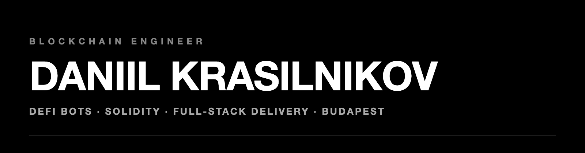

Budapest, Hungary · [krasilnikoff.dev](https://krasilnikoff.dev)

Build fast. Be useful. Iterate.

---

## NOW

- I build trading systems, from the core logic to on-chain execution: Rust, C++, Solidity.
- I ship the product around them: React and React Native apps.
- Open to contract work with crypto and fintech teams.

---

## TRACK RECORD

| Where | What |
|---|---|
| **Bourse Direct** | Senior Software Engineer. Core trading logic in Rust and C++. Order validation and matching 3x faster. |
| **Private trading firm** | Blockchain Engineer & Researcher. Designed production DeFi trading bots: Solidity smart contracts and on-chain execution strategies. |
| **[Terra.do](https://terra.do)** | Senior Frontend Developer. Cross-platform React Native app, App Store and Play Store releases, Next.js + Storybook. |
| **MobiOffice** | Frontend Engineer. Accessibility score up 20%. Test coverage to 82%. |

---

## PROJECTS

| Project | What it is |
|---|---|
| **[KC&C](https://krasilnikoff.cc)** | Krasilnikoff Credit & Collateral. Daily credit and collateral data on Canton Coin. Every figure has a source, and the method is public. |
| **[Rounds](https://saverounds.vercel.app)** | No-loss up/down market on Monad. Only the prize pool trades; a wrong call gets the whole deposit back. [Code](https://github.com/kovdanielgh/rounds). |
| **[Willhappen](https://willhappen.io)** | Prediction markets on Hyperliquid. Prices come from HIP-4 order books. |
| **[Rosa Protocol](https://github.com/kovdanielgh/rosa-protocol)** | Open-source communication protocol for decentralized robot swarms. |
| **[DeFi Trading Bots](https://krasilnikoff.dev/work/defi-trading-bots)** | Production bots with Solidity contracts on Ethereum and BSC. Code is private. |

More on [krasilnikoff.dev](https://krasilnikoff.dev/work).

---

## STACK

```
Rust · C++ · low-latency trading systems
Solidity · smart contracts · DeFi protocols · on-chain execution
TypeScript · React · Next.js · React Native
Microservices · CI/CD · ROS · IoT · Edge AI
```

---

## CONTACT

[Portfolio](https://krasilnikoff.dev) · [LinkedIn](https://www.linkedin.com/in/daniel-krasilnikoff/) · [Email](mailto:kovdaniel.job@gmail.com)
